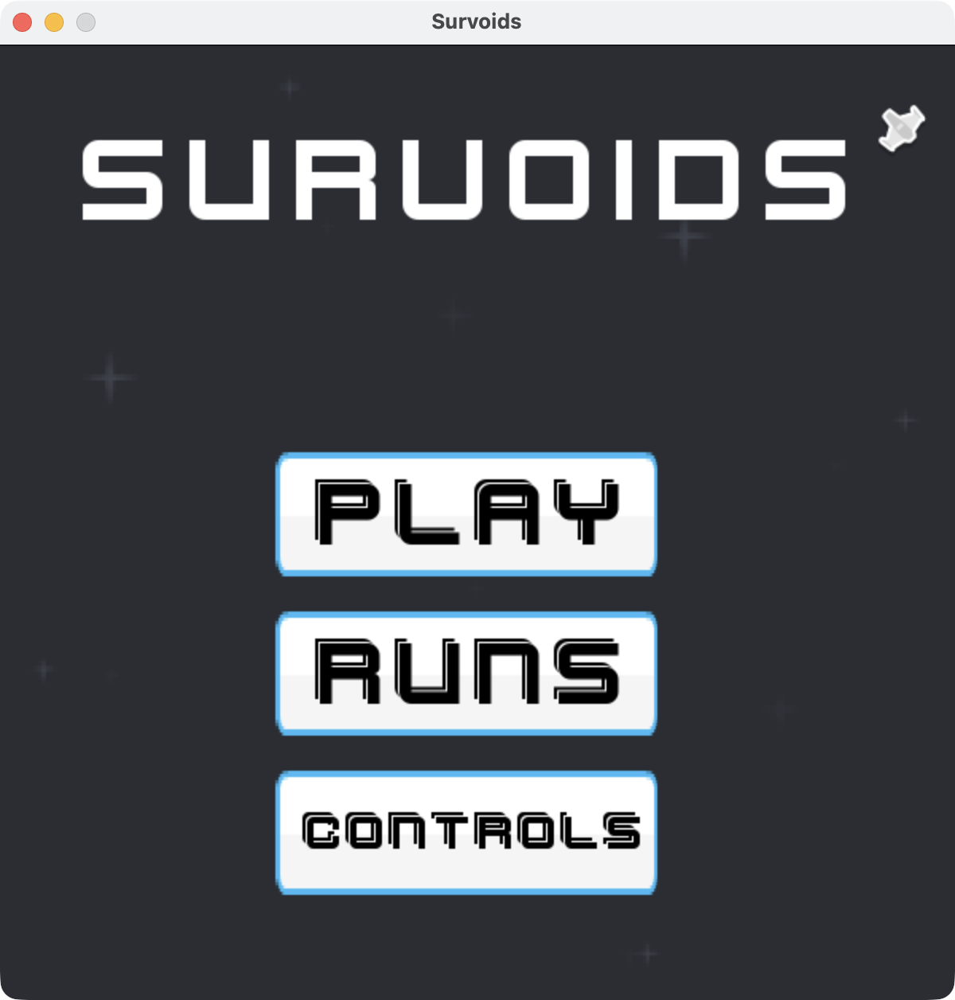
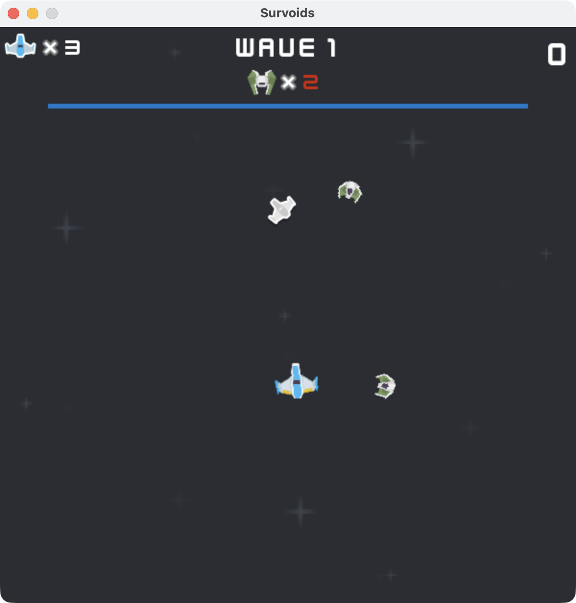
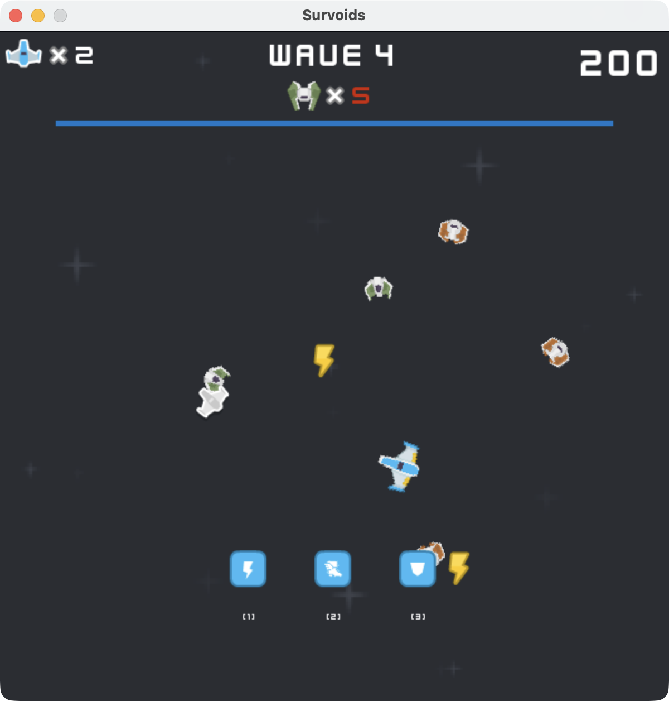
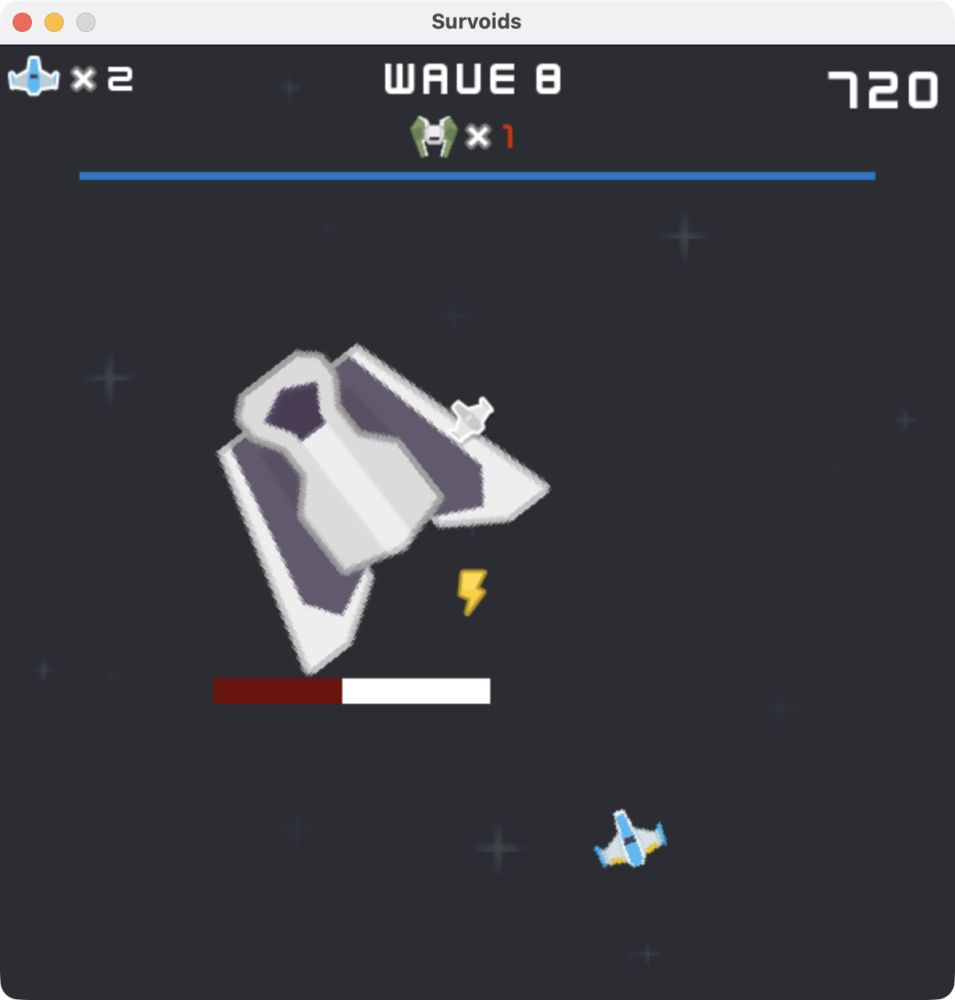
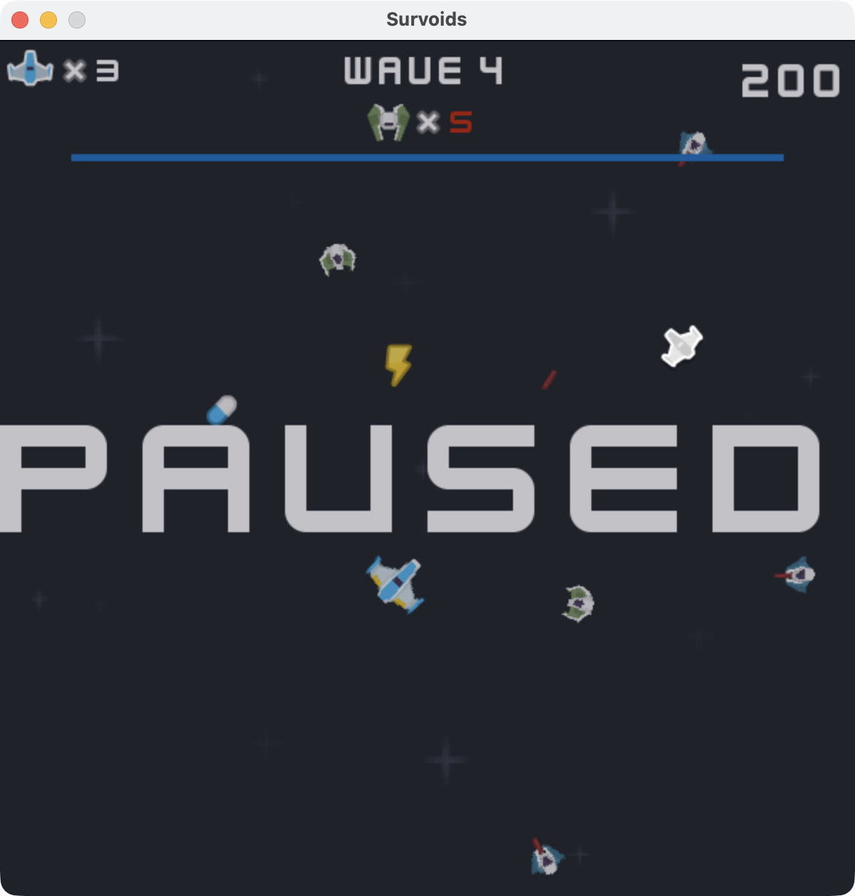
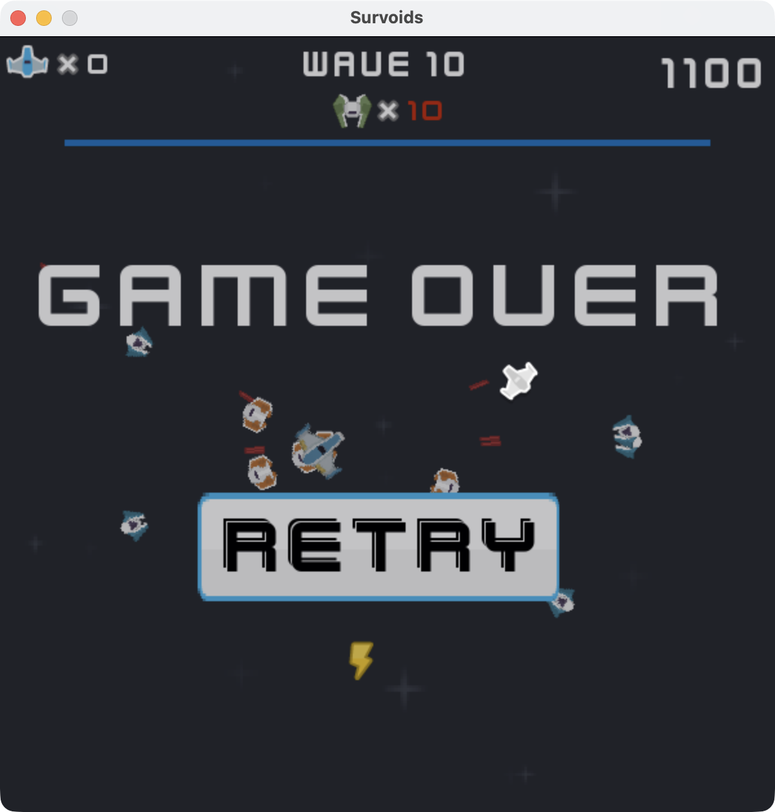
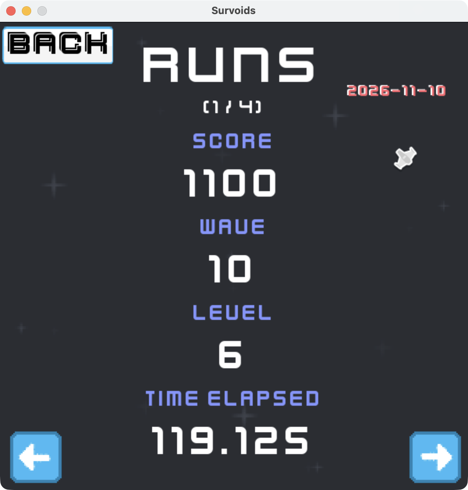
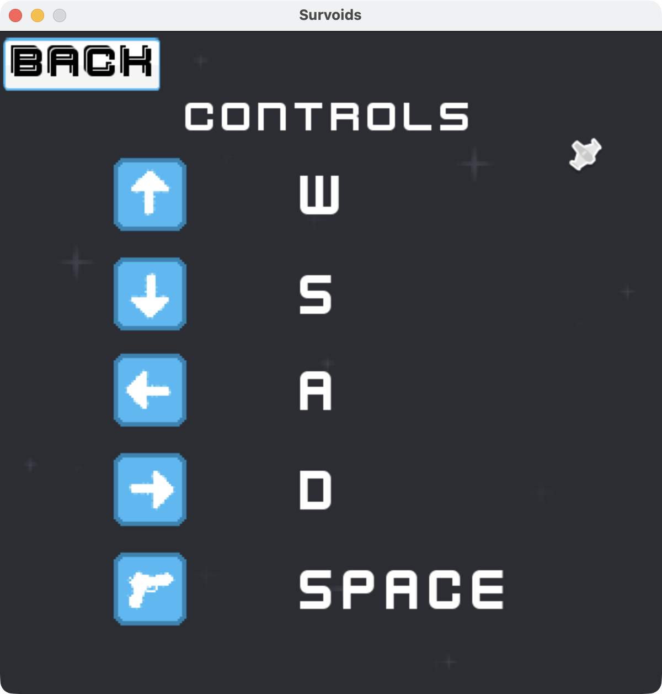
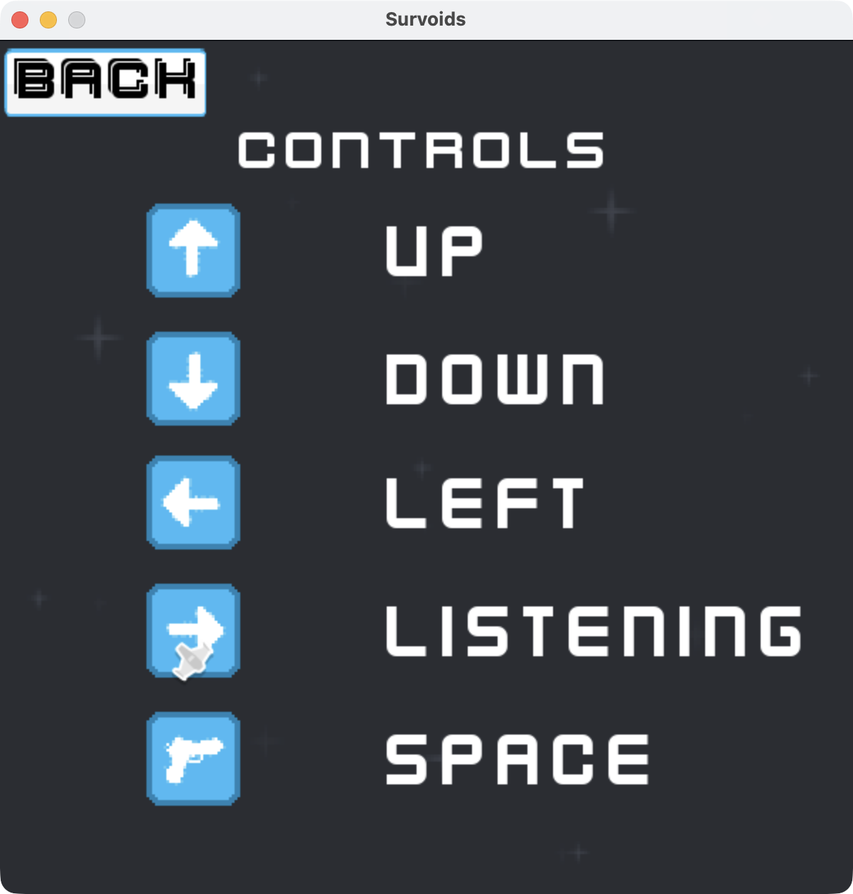

<div align="center">
    <h1> Survoids </h1>
    <blockquote> A <b>2D space-shooter roguelike</b> game inspired by <em>Asteroids</em> and <em>Vampire Survivors.</em></blockquote>
    <br>


</div>

This game is adapted from a game I made using *Pygame Zero*.

The purpose of **Survoids** to learn *Pygame-CE* and demonstrate my *Python* skills.

## Gameplay Features
<a id="gameplay-gif"></a>

<br>

 - **[Fight](#in-game) endless waves of enemies of four types**
 - **[Move](#gameplay-gif) with space-like physics**
 - **[Level](#level-and-buff) up and choose an upgrade to your ship**
 - **[Collect](#level-and-buff) buffs dropped by enemies for temporary power**
 - **[Retry](#retry) to try and beat your previous runs**
 - **[Pause](#pause) the game if you need to take a break**
 - **[See](#previous-runs) all your previous runs**
 - **[Remap](#remap-controls) your controls to your choice**

## Skills Demonstrated in Survoids
 - **Object-Oriented Programming**: Creating objects for sprites such as `Player`, `Enemy`, `Bullet` and `Text`.
 - **Data Persistence**: Saving permanent controls and run data to `controls.txt` and `game_results.txt`.
 - **Dependency Injection**: Passing data to and from functions and objects as they require it, having no global variables.
 - **Event-Driven Programming**: Handling player input in the main event loop every frame to trigger custom game events.
 - **State Management**: Tracking the game's state throughout execution using the `game_state` variable.

## How to Play
### Requirements
 - **Python 3.10+**
 - **pip**
 - **Pygame-CE**

### Windows and MacOS Release
1. Navigate to the **releases** tab and find **Survoids - v1.0.0 Release**, or click **[here](https://github.com/prixdj/Games/releases/tag/Survoids-v1.0.0)**.
2. Follow the instructions *based on your operating system* to play.

### Source Code and Linux Users
This will allow you to run **Survoids** from source, given you have **Python (3.10+)** and **pip**.

**IMPORTANT: You do not need to do this if you will only download the Windows or MacOS release of a game.**

1. **Open a terminal or an app that accesses the terminal.**

2. **Clone the repository.**

***Optional**: Put the path to where you want the cloned repository to be at the end of the command. If you do not do this, it will create the folder in your current directory.*
```bash
git clone https://github.com/prixdj/Games.git
```

3. **Navigate to the repository folder.**
```bash
cd Games
```
***Note**: If you had put the path to where you wanted the cloned repository to be, you must change your directory to there first.*
```bash
git clone https://github.com/prixdj/Games.git <path/to/your/folder>
cd <path/to/your/folder>/Games
```

4. **Create a python environment.**
 - If you are on **Windows**, **run**:
```bash
python -m venv .venv
.venv\Scripts\activate
```
 - If you are on **MacOS** or **Linux**, **run**:
```bash
python3 -m venv .venv
source .venv/bin/activate
```

5. **Install requirements: Pygame-CE**
```bash
python -m pip install -r requirements.txt
```
6. **Run Survoids.**
```bash
python survoids.py
```

## Gameplay Images
##### The main screen of Survoids.


<a id="in-game"></a>
##### In game preview.


<a id="level-and-buff"></a>
##### Levelling up allows you to choose an upgrade, killing enemies may drop temporary buffs.


##### Fight a huge boss enemy.


<a id="pause"></a>
##### Pause the game if you need to take a break.


<a id="retry"></a>
##### If you die, click retry to try again.


<a id="previous-runs"></a>
##### See your previous runs.


##### See the controls of the game.


<a id="remap-controls"></a>
##### Remap the controls to how you want them.


## Disclaimers
### Usage of Third Party Assets
 - **[Space Shooter Remastered Asset Pack](https://kenney.nl/assets/space-shooter-remastered)** from *Kenney Assets*

### License
This project is licensed under the **[MIT License](LICENSE)**.

## Development Environment
 - **Windows 10** and **macOS Tahoe 26+**
 - **Miniconda Python v3.13.5**
 - **pip v25.1**
 - **Pygame Community Edition v2.5.8**
 - **PyInstaller v6.22.3**
 - **Krita v5.2.3**