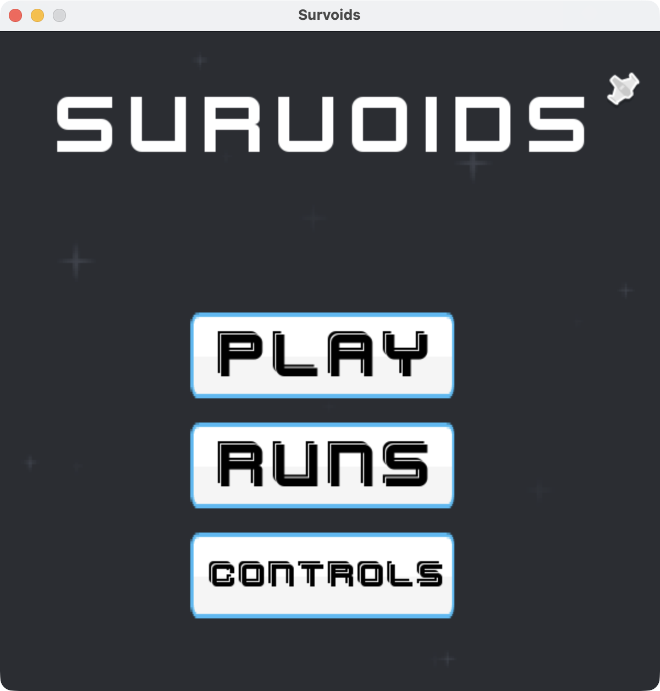
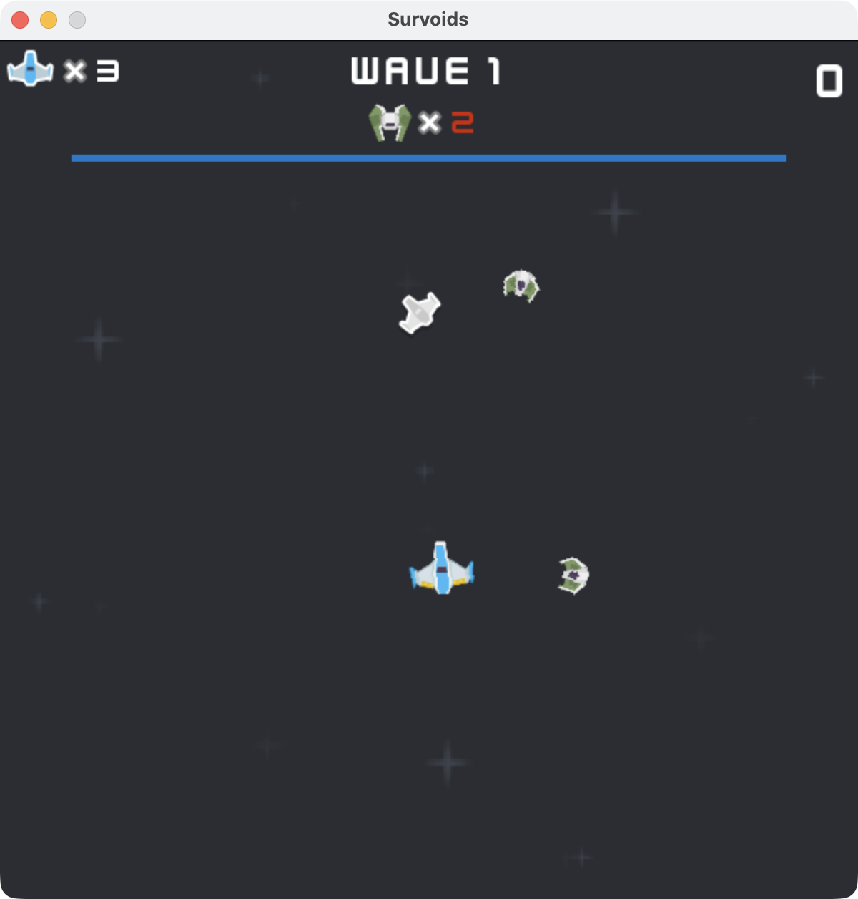
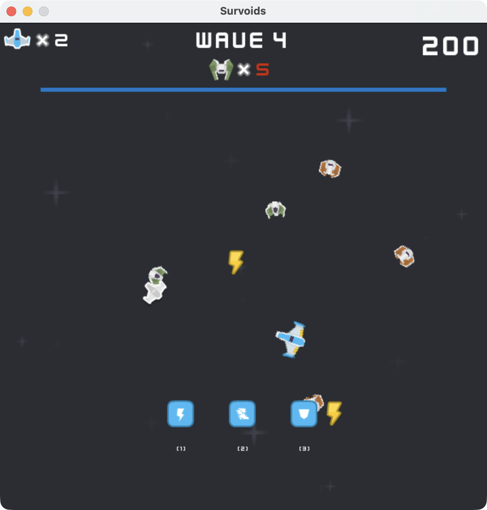
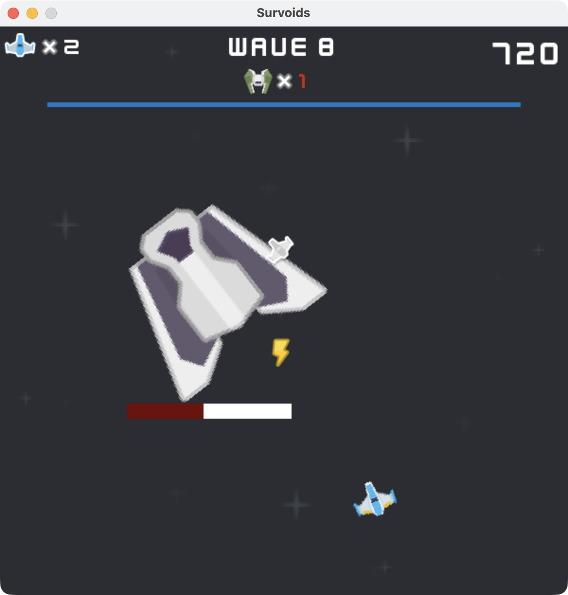
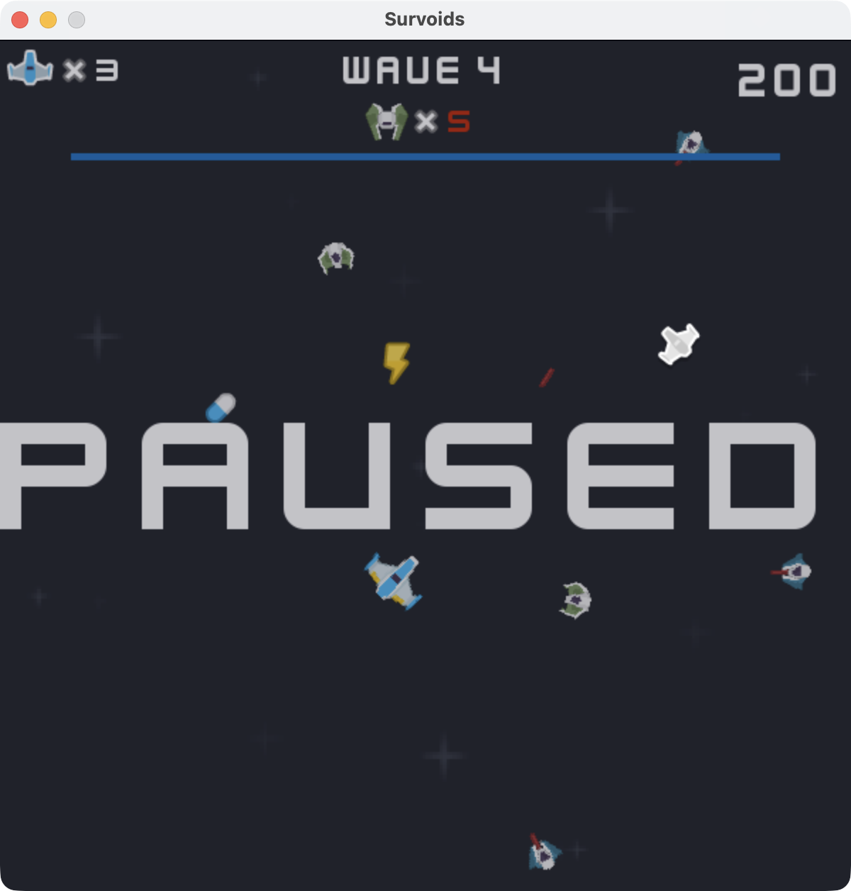
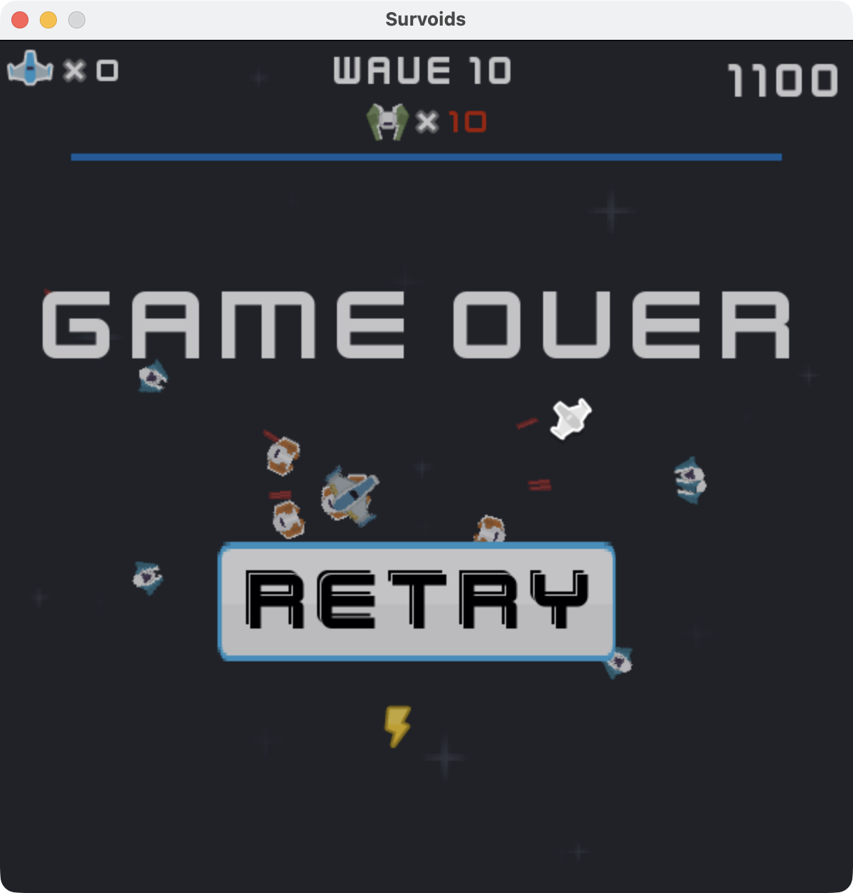
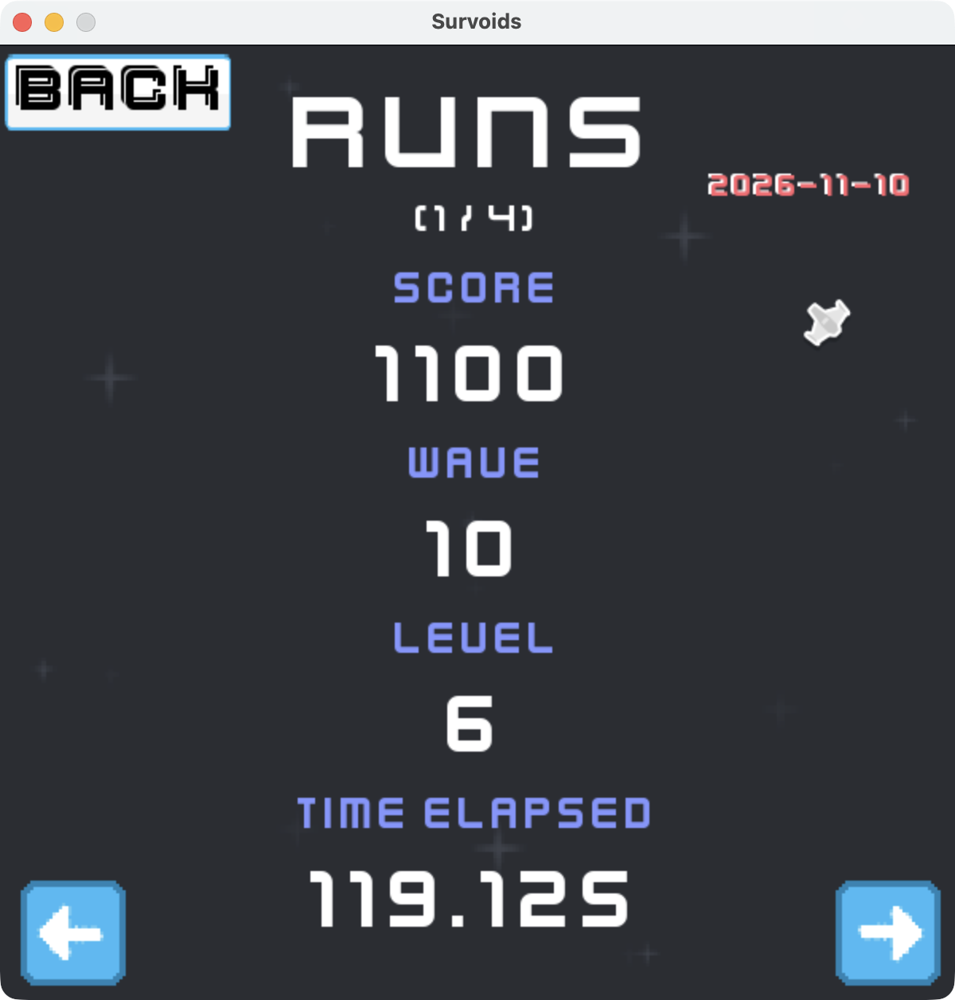
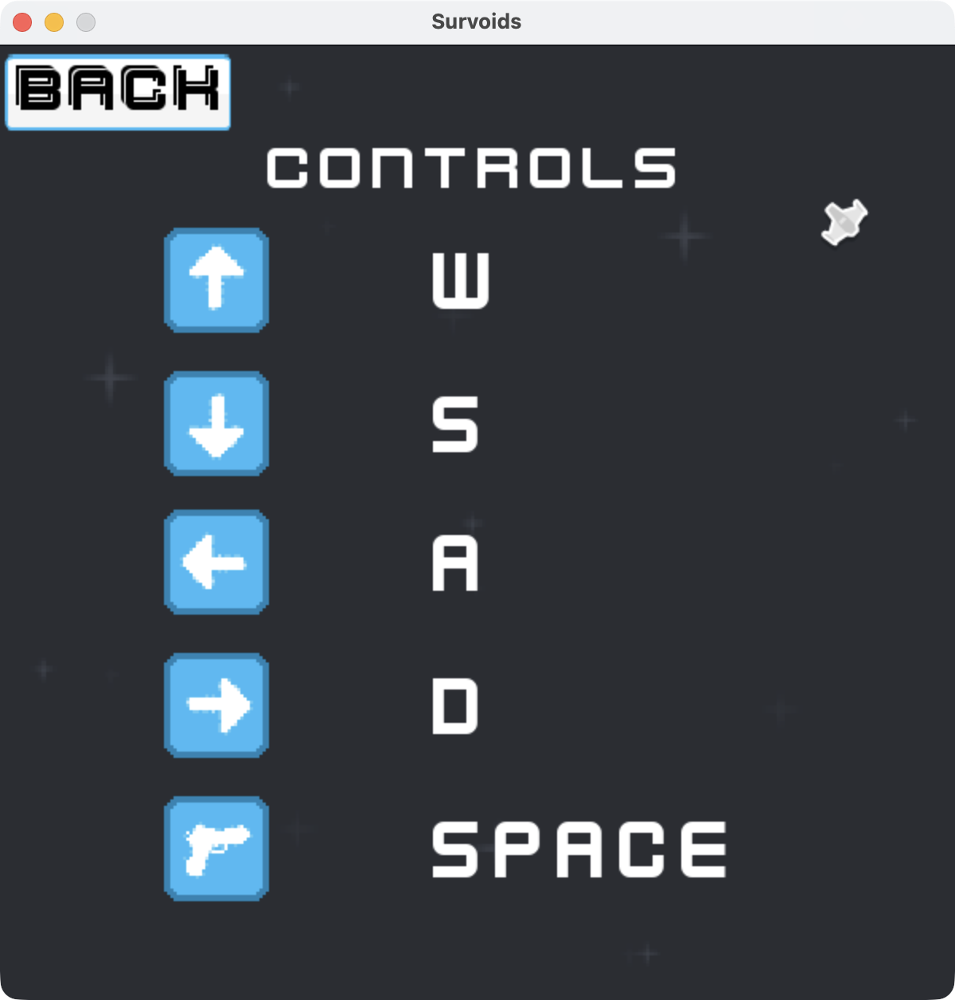
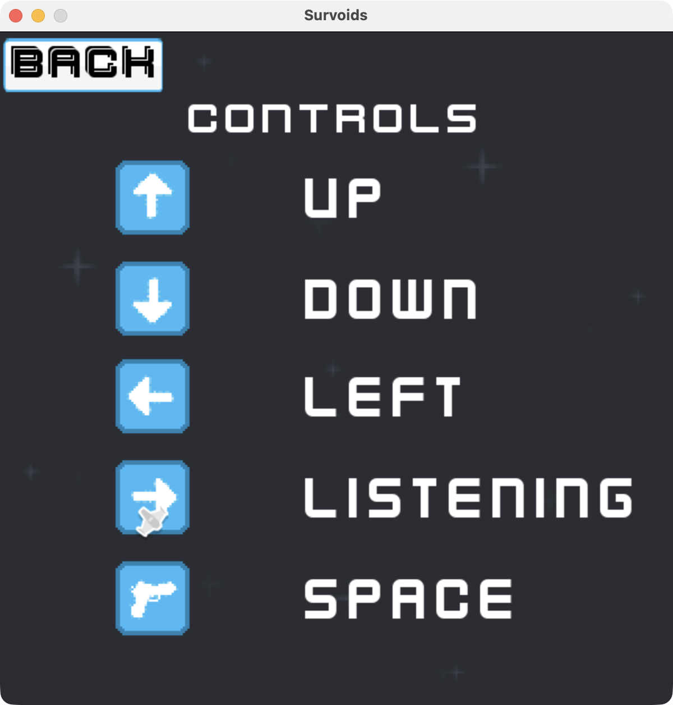

<div align="center">
    <h1> Survoids </h1>
    <blockquote> A <b>2D space shooter roguelike</b> game inspired by <em>Asteroids</em> and <em>Vampire Survivors.</em></blockquote>
    <br>


</div>

This game is adapted from a game I made using *Pygame Zero*.

The purpose of **Survoids** to learn *Pygame-CE* and demonstrate my *Python* skills.

## Gameplay Features
 - **Fight endless waves of enemies of four types**
 - **Move with space-like physics**
 - **Level up and choose an upgrade to your ship**
 - **Collect buffs dropped by enemies for temporary power**
 - **Retry to try and beat your previous runs**
 - **Pause the game if you need to take a break**
 - **See all your previous runs**
 - **Remap your controls to your choice**

## Skills Demonstrated in Survoids
 - **Data Persistence**: Saving controls and run data to `controls.txt` and `game_results.txt`.
 - **Dependency Injection**: Passing data to and from functions and objects as they require it, having no global variables.
 - **Event-Driven Programming**: Handling player input in the main event loop every frame to trigger custom game events.
 - **State Management**: Tracking the game's state throughout execution using the `game_state` variable.
 - **PEP 8 Compliance**: Ensuring best-practice code formatting through the use of Ruff.

## Requirements
 - **Python 3.10+**
 - **pip**
 - **Pygame-CE**

## Running Survoids
### Windows and MacOS Release
1. Navigate to the **releases** tab and find **Survoids - v1.0.0 Release**, or click **[here](https://github.com/prixdj/Games/releases/tag/Survoids-v1.0.0)**.
2. Follow the instructions *based on your operating system* to play.

### Source Code and Linux Users
 - Follow the **[General Setup instructions](https://github.com/prixdj/Games#general-setup)**, then **run**:
```bash
python survoids/survoids.py
```

## Gameplay Images

*The main screen of Survoids.*
<br><br>


*In game preview.*
<br><br>


*Levelling up allows you to choose an upgrade, killing enemies may drop temporary buffs.*
<br><br>


*Fight a huge boss enemy.*
<br><br>


*Pause the game if you need to take a break.*
<br><br>


*If you die, click retry to try again.*
<br><br>


*See your previous runs.*
<br><br>


*See the controls of the game.*
<br><br>


*Remap the controls to how you want them.*

## Disclaimers
### AI Disclaimer
 - **No AI** was used for any code generation or checking code other than helping with path correction and PyInstaller.
 - AI was **used for learning** about code.

### Usage of Third Party Assets
 - **Space Shooter Remastered Asset Pack** from *Kenney Assets*

### License
This project is licensed under the [MIT License](../LICENSE).

## Development Environment
 - **Windows 10** and **macOS Tahoe 26+**
 - **Miniconda Python v3.13.5**
 - **pip v25.1**
 - **Pygame Community Edition v2.5.8**
 - **PyInstaller v6.22.3**
 - **Krita v5.2.3**